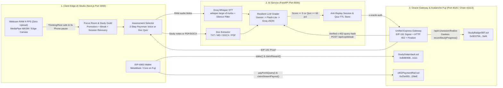

# MindSpark: AI-Supervised Proof of Cognitive Effort on Avalanche

[](https://github.com/NGUYENHUUTINH-uit/mindspark-unihack/actions)
[-E84142?logo=avalanche)](https://testnet.snowtrace.io/address/0xB4B96B56E7b86ed7484Fe26919c509E14E6fb111)
[](#-automated-tests--reproducible-verification)
[](https://opensource.org/licenses/MIT)

> **UniHack 2026 (Greenwich Vietnam & Avalanche)**  
> **Track:** Social Finance & AI Agent Economy on x402  
> **Quick Navigation:** [Live Fuji Contracts](#-deployed-smart-contracts-avalanche-fuji-testnet) · [Judging Alignment](#-unihack-2026-judging-rubric-alignment) · [Architecture](#%EF%B8%8F-3-tier-system-architecture) · [Privacy & Anti-Cheat](#%EF%B8%8F-security-privacy--anti-cheat-matrix) · [Privacy Whitepaper](docs/PRIVACY_WHITEPAPER.md) · [Hướng dẫn Setup & Demo (Tiếng Việt)](docs/DEMO_AND_SETUP_GUIDE.md)

---

## Abstract & Problem Statement

Traditional productivity timers and Study-to-Earn applications fail on three structural dimensions:

1. **Smartphone Distraction:** Over 70% of self-study interruptions come from involuntary phone pickups that passive countdown timers cannot detect or pause for.
2. **Passive Tab-Camping Exploits:** Time-only reward apps allow users to leave an idle browser tab open or loop pre-recorded webcam footage while earning incentives without studying.
3. **Cloud Webcam Privacy Risk:** Streaming raw student video to remote inference servers violates personal privacy and consumes high bandwidth.

**MindSpark** introduces **Proof of Cognitive Effort (PoCE)** — a 3-tier decentralized protocol combining **zero-upload Edge-AI vision** inside browser RAM, **2-step Feynman active recall** (Groq Whisper STT + Gemini / Groq LLM grading with document-grounded Quiz fallback), and **bidirectional x402 micropayments + Dynamic Soulbound NFTs (SBT)** deployed live on **Avalanche Fuji Testnet (`chainId: 43113`)**.

---

## 🏆 UniHack 2026 Judging Rubric Alignment

| Evaluation Criterion | MindSpark Implementation | Evidence in Repository |
| :--- | :--- | :--- |
| **Avalanche Network Deployment** | Deployed 3 interconnected Solidity `^0.8.24` contracts on **Avalanche Fuji C-Chain (`43113`)** using OpenZeppelin `Ownable`, `ReentrancyGuard`, `ECDSA`, and dynamic on-chain `ERC-721` SVG. | [deployed-addresses.json](contracts/deployed-addresses.json), [StudyStakeVault.sol](contracts/contracts/StudyStakeVault.sol), [StudyBadgeSBT.sol](contracts/contracts/StudyBadgeSBT.sol), [x402PaymentRail.sol](contracts/contracts/x402PaymentRail.sol) |
| **x402 Agent Economy & Social Finance** | Bidirectional **HTTP 402** value rail: (1) **Inverted Bounty Stream** — sponsors fund `totalBountyPool` and students claim `0.0001 AVAX/min` for verified focus; (2) **Pay-per-Query** — students pay `0.005 AVAX` on-chain via `payForAiQuery(queryHash)` to unlock Gemini Socratic Copilot & flashcards. | [x402Middleware.js](contracts/services/x402Middleware.js), [apiGateway.js](contracts/services/apiGateway.js), [FlashcardNotebook.tsx](frontend/src/components/FlashcardNotebook.tsx) |
| **AI Innovation & Resilience** | Browser-local **4 FPS Edge-AI** (`MediaPipe PoseLandmarker` + `FaceLandmarker` + int8 `ObjectDetector` for real `"cell phone"` & `"person"` detection, plus deterministic spatial Canvas fallback) classifying 6 study poses with two-hand `Thinking / Rest` exclusion, 1.5s absence trigger, and blink liveness; paired with Groq `whisper-large-v3-turbo` STT + resilient Gemini/Groq LLM grading + `.txt/.md/.docx/.pdf` Quiz extraction. | [usePoseTracker.ts](frontend/src/hooks/usePoseTracker.ts), [feynman.py](ai-service/app/routers/feynman.py), [quiz.py](ai-service/app/routers/quiz.py), [llm.py](ai-service/app/services/llm.py) |
| **Cryptographic Anti-Cheat & Privacy** | Zero raw frames leave the device; silence-hallucination filter rejects empty mic artifacts; `<transcript>` XML sandbox blocks prompt injection; EIP-191 attestation binds `(student, minutes, score, nonce, chainId, vault)` to prevent tampering & cross-chain replay; pre-claim Gateway-vs-Chain oracle key diagnostic prevents reverted claims. | [PRIVACY_WHITEPAPER.md](docs/PRIVACY_WHITEPAPER.md), [oracleSigner.js](contracts/services/oracleSigner.js), [ResultModal.tsx](frontend/src/components/ResultModal.tsx) |
| **Engineering Quality & Verification** | Monorepo CI pipeline covering all 3 tiers: **31/31** Hardhat + Oracle + Gateway tests, **53/53** FastAPI Pytest tests, and clean **Next.js 16** TypeScript production build. | [.github/workflows/ci.yml](.github/workflows/ci.yml) |

---

## 🏗️ 3-Tier System Architecture



### End-to-End Protocol Lifecycle

1. **Stake & Session Recovery:** The student enters any study topic (no forced preset), chooses study & break duration, and stakes **`0.01 AVAX`** into `StudyStakeVault.stake(targetMinutes, durationDays)`. On reconnect/reload, `userSessions(address)` detects any active on-chain stake and offers one-click resume or immediate assessment withdrawal.
2. **Privacy-Preserving Edge-AI Monitoring:** At 4 FPS on local RAM, `usePoseTracker` pairs MediaPipe `PoseLandmarker`, `FaceLandmarker`, and int8 `ObjectDetector` (`efficientdet_lite0`) to classify `Writing Pose`, `Reading Pose`, `Screen Focus`, `Thinking / Rest` (hands raised symmetrically to head/temples never penalized when no phone is present), `Phone Distraction` (real `"cell phone"` object detection in ~0.75s or single-hand near-ear/chin backup, with a 5s warning before auto-pausing timer with chime), and `Drowsy / Absent` (triggered in 1.5s when both `FaceLandmarker` and `"person"` detector lose presence, pausing after 5s), while tracking blink/motion liveness (`isLiveSubject`, `livenessScore`).
3. **Interactive Assessment Selector (No Forced Mic Ambush):** Upon completing the focus timer (or finishing early), the student chooses:
   * **Mode A — 2-Step Feynman Voice:** Record up to 30s (adaptive MIME `webm/opus` -> `mp4` -> `ogg`), automatically flush audio before stream teardown, transcribe via `POST /api/feynman/transcribe`, **replay audio & inspect/edit transcript** (with live `15-word` minimum counter), and grade via `POST /api/feynman/evaluate-text`.
   * **Mode B — Document-Grounded AI Quiz:** Upload `.txt`, `.md`, `.docx`, `.pdf`, `.csv`, `.json`, or enter any topic (`POST /api/quiz/extract-file` + `/api/quiz/generate`), answer 5 shuffled MCQs, and pass at `>= 60%` (`>= 3/5`).
   * **Pomodoro Break:** Pause webcam enforcement safely with `0.01 AVAX` stake intact on-chain before starting assessment.
4. **3-Stream Reward Settlement & Dynamic SBT:** Verified `claimReward()` triggers `/api/v1/session/finalize`, which verifies the on-chain `RewardClaimed` receipt, records progress gaslessly on `StudyBadgeSBT` (updating Level 1–5 on-chain SVG metadata + EXP), and signs the `x402PaymentRail` per-minute stream voucher when `totalBountyPool` covers payout.

---

## 🚀 Deployed Smart Contracts (Avalanche Fuji Testnet)

All contracts are deployed on **Avalanche Fuji C-Chain (`chainId: 43113`, RPC: `https://api.avax-test.network/ext/bc/C/rpc`)** with on-chain `oracleSigner = 0xA206B966480E6eeE2F3F96e6958899e71501B8e2`:

| Contract | Address | Explorer | Core Responsibilities |
| :--- | :--- | :--- | :--- |
| **StudyStakeVault** | `0xB4B96B56E7b86ed7484Fe26919c509E14E6fb111` | [View on Snowtrace](https://testnet.snowtrace.io/address/0xB4B96B56E7b86ed7484Fe26919c509E14E6fb111) | Locks student commitment stake (`MINIMUM_STAKE = 0.01 AVAX`, `targetMinutes >= 30`), verifies EIP-191 Oracle signatures via `claimReward`, distributes 10% `penaltyPool` bonuses, and exposes `penalize()` + `fundBountyPool()`. |
| **StudyBadgeSBT** | `0x9D3756BeE86E9FF34773B4D3f9E323FfdD8F3afA` | [View on Snowtrace](https://testnet.snowtrace.io/address/0x9D3756BeE86E9FF34773B4D3f9E323FfdD8F3afA) | Non-transferable ERC-721 (`_update()` reverts transfers), mints 1 Soulbound badge per address, evolves Levels 1–5 (`Novice` to `Grandmaster Scholar`), and generates JSON + SVG art 100% on-chain via `tokenURI()`. |
| **x402PaymentRail** | `0x25e95555fed513Cb0d5a4Cb9FA0e2A698F5ED9eE` | [View on Snowtrace](https://testnet.snowtrace.io/address/0x25e95555fed513Cb0d5a4Cb9FA0e2A698F5ED9eE) | Manages `totalBountyPool` sponsor scholarships (`0.0001 AVAX/min` via `claimStreamPayout`) and HTTP 402 micropayments (`aiQueryPrice = 0.005 AVAX` via `payForAiQuery` & `isQueryPaid`). |

---

## 🛡️ Security, Privacy & Anti-Cheat Matrix

| Risk / Attack Vector | Mitigation Implemented | Verification / Source |
| :--- | :--- | :--- |
| **Webcam Video Leakage** | Zero pixels or video blobs are ever transmitted or persisted; Canvas (`160x120`) and MediaPipe WASM run strictly inside volatile browser RAM (`stop()` revokes tracks immediately). | [PRIVACY_WHITEPAPER.md](docs/PRIVACY_WHITEPAPER.md), [usePoseTracker.ts](frontend/src/hooks/usePoseTracker.ts) |
| **Static Photo / Deepfake Spoofing** | Eye-blink blendshape detection (`FaceLandmarker`) paired with inter-frame motion variance flags `isLiveSubject = false` if static > 7s. | [usePoseTracker.ts](frontend/src/hooks/usePoseTracker.ts) |
| **False Phone Positives (Hands on Head)** | Symmetric two-hand raises & above-forehead posture classify safely as `Thinking / Rest` whenever no real phone is present; `Phone Distraction` uses int8 `ObjectDetector` (`"cell phone"`) confirmation (`~0.75s`) plus `1.5s` pose-zone backup, and `Drowsy / Absent` triggers after `1.5s` without face or person presence. | [usePoseTracker.ts](frontend/src/hooks/usePoseTracker.ts) |
| **Whisper Silence Hallucinations** | Empty-mic Whisper artifacts (`"Thank you."`, `"thanks for watching"`, `"đăng kí cho kênh lalaschool..."`, etc.) are stripped to `""` (`likely_silence: true`) and shown on the review screen before grading. | [stt.py](ai-service/app/services/stt.py), [test_feynman_llm.py](ai-service/tests/test_feynman_llm.py) |
| **Feynman Prompt Injection / Gibberish** | Student speech is sandboxed inside `<transcript>...</transcript>`; evaluator enforces `word_count >= 15`, `not is_gibberish`, and `score >= 5`. | [llm.py](ai-service/app/services/llm.py), [feynman.py](ai-service/app/routers/feynman.py) |
| **Signature Forgery / Replay / Cross-Chain** | Vault hashes `(msg.sender, completedMinutes, feynmanScore, currentNonce, block.chainid, address(this))`, increments `userNonces` atomically, and checks `ECDSA.recover(...) == oracleSigner`. | [StudyStakeVault.sol](contracts/contracts/StudyStakeVault.sol), [oracleSigner.js](contracts/services/oracleSigner.js) |
| **Quiz Answer Leakage / Reuse** | Generated questions strip `correct_index` & `explanation` before returning to client; `session_store` deletes `quiz_id` after 1 submission and enforces 1 proof per `session_id` (`409 Conflict`). | [quiz.py](ai-service/app/routers/quiz.py), [test_quiz_api.py](ai-service/tests/test_quiz_api.py) |
| **Oracle Signer Mismatch Pre-Check** | `GET /health` reports `onChainOracleAddress` & `oracleKeyMatchesChain`; `ResultModal` cross-checks Vault `oracleSigner()` and blocks blind mis-signed claims with diagnostics. | [apiGateway.js](contracts/services/apiGateway.js), [ResultModal.tsx](frontend/src/components/ResultModal.tsx) |
| **SBT Transfer / Wash Trading** | Overridden ERC-721 `_update()` reverts any `from != 0 && to != 0` transfer. | [StudyBadgeSBT.sol](contracts/contracts/StudyBadgeSBT.sol) |

---

## 📡 API Reference

### AI Service (`http://localhost:8000`)

| Method & Endpoint | Auth | Purpose |
| :--- | :---: | :--- |
| `GET /health` | None | Service liveness & version check. |
| `POST /api/feynman/transcribe` | None | Step 1 Voice AI: transcribes RAM audio multipart (`<= 5 MB`) via Groq Whisper with silence-hallucination filtering. |
| `POST /api/feynman/evaluate-text` | None | Step 2 Voice AI: evaluates reviewed/edited transcript via LLM, extracts flashcards, and requests EIP-191 Oracle proof. |
| `POST /api/feynman/evaluate` | None | Legacy single-shot audio-to-proof endpoint (preserved for compatibility). |
| `POST /api/quiz/extract-file` | None | Extracts clean study text (`<= 9500` chars) & suggested topic from `.txt`, `.md`, `.csv`, `.json`, `.tex`, `.docx` (stdlib ZIP/XML), or `.pdf` (`<= 10 MB`). |
| `POST /api/quiz/generate` | None | Generates & shuffles 5 topic/document-grounded MCQs using Gemini -> Flash-Lite -> Groq JSON fallback. |
| `POST /api/quiz/submit` | None | Server-side grading (`>= 60%` pass threshold), flashcard extraction, and Oracle proof issuance. |
| `POST /api/copilot/ask` | `x-oracle-auth` | Internal endpoint invoked by x402 Gateway after on-chain payment confirmation; returns Socratic explanation + flashcard. |

### Unified Web3 & x402 Gateway (`http://localhost:4020`)

| Method & Endpoint | Auth / Payment | Purpose |
| :--- | :---: | :--- |
| `GET /health` | None | Reports RPC block, Gateway signer address, live `onChainOracleAddress`, `oracleKeyMatchesChain`, and deployed contract addresses. |
| `POST /api/v1/oracle/attest` | `x-oracle-auth` | Generates EIP-191 study proof after checking active session & reading live `userNonces`. |
| `POST /api/v1/oracle/demo-attest` | Opt-in Flag | Issues fixed-score (`75`) demo proof only when `ENABLE_DEMO_ATTEST=true`. |
| `GET /api/v1/oracle/session/:studentAddress` | None | Queries `userSessions` and `userNonces` on `StudyStakeVault`. |
| `POST /api/v1/session/finalize` | Verified `txHash` | Validates `RewardClaimed` receipt, triggers gasless `StudyBadgeSBT.recordStudyProgress()`, and signs `claimStreamPayout()` if Bounty Pool suffices. |
| `POST /api/v1/ai/ask-expert` | HTTP `402` On-Chain | Challenges unpaid calls with `402 Payment Required` (`0.005 AVAX`); verifies `x402PaymentRail.isQueryPaid(queryHash)` before unlocking AI Copilot. |
| `GET /api/v1/x402/bounty-pool` | None | Reads live sponsor scholarship balance (`totalBountyPool`) and rate (`0.0001 AVAX/min`). |

---

## 🧪 Automated Tests & Reproducible Verification

Every test suite is automated via [`.github/workflows/ci.yml`](.github/workflows/ci.yml) and verified locally:

```powershell
# 1. Smart Contracts & Gateway Tests (31/31 passing)
cd contracts
npm install --force
npx hardhat test

# 2. AI Service Pytest Suite (53/53 passed)
cd ../ai-service
.\.venv\Scripts\python.exe -m pytest -v

# 3. Frontend TypeScript & Production Build (exit code 0)
cd ../frontend
npm install
npm run build
```

Optional on-chain diagnostic scripts inside `contracts/`:
```powershell
node scripts/dry-run-e2e.js
npx hardhat run scripts/verify-all.js --network fuji
```

---

## ⚡ Quick Start for Judges & Evaluators

> 👉 **Dedicated Vietnamese Teammate & Live Demo Playbook:** See **[docs/DEMO_AND_SETUP_GUIDE.md](docs/DEMO_AND_SETUP_GUIDE.md)** for full browser wallet installation steps, key configuration checklist, 3-minute pitch walkthrough, Q&A answers, and troubleshooting.

### 1. Prerequisites
* **Node.js** `>= 20`, **Python** `>= 3.11`, **Git**.
* Browser Extension: **MetaMask** or **Core Wallet** connected to **Avalanche Fuji Testnet (`Chain ID: 43113`)** with test AVAX from [faucet.avax.network](https://faucet.avax.network/).

### 2. Configure Local `.env` Files (from `.env.example` templates)
* [`contracts/.env.example`](contracts/.env.example) → copy to `contracts/.env`: set `ORACLE_PRIVATE_KEY` / `FUJI_PRIVATE_KEY` matching on-chain `oracleSigner` (`0xA206B966480E6eeE2F3F96e6958899e71501B8e2`) for live `claimReward()` & gasless SBT updates (or deploy your own test contracts via `npx hardhat run scripts/deploy.js --network fuji`).
* [`ai-service/.env.example`](ai-service/.env.example) → copy to `ai-service/.env`: set `GROQ_API_KEY` and `GEMINI_API_KEY` (defaults use `whisper-large-v3-turbo` and `gemini-3.5-flash-lite`).
* [`frontend/.env.example`](frontend/.env.example) → copy to `frontend/.env.local`.

### 3. Launch All 3 Services (3 Terminals)

```powershell
# Terminal 1 — Oracle & x402 Gateway (Port 4020)
cd contracts
node services/apiGateway.js

# Terminal 2 — AI Service (Port 8000)
cd ai-service
.\.venv\Scripts\python.exe -m uvicorn app.main:app --reload --port 8000

# Terminal 3 — Next.js Studio DApp (Port 3000)
cd frontend
npm run dev
```

Open **[http://localhost:3000](http://localhost:3000)** to evaluate the full **Stake -> Edge-AI Studio Camera -> Assessment Selector (Feynman 2-Step / Doc Quiz) -> Claim Vault + Gasless SBT Mint -> x402 Flashcard Copilot** journey.

---

## 📁 Monorepo Structure

```text
mindspark-unihack/
├── .github/workflows/ci.yml        # 3-stage CI (Hardhat, Pytest, Next.js build)
├── docs/
│   ├── DEMO_AND_SETUP_GUIDE.md     # Vietnamese setup & 3-minute live demo playbook
│   └── PRIVACY_WHITEPAPER.md       # Zero-Video-Transmission & cryptographic security spec
├── contracts/
│   ├── contracts/                  # StudyStakeVault.sol, StudyBadgeSBT.sol, x402PaymentRail.sol
│   ├── services/                   # apiGateway.js, oracleSigner.js, oracleServer.js, x402Middleware.js
│   ├── scripts/                    # deploy*.js, verify-all.js, demo-*.js, dry-run-e2e.js
│   ├── test/                       # Hardhat + Gateway test suite (31 tests)
│   └── deployed-addresses.json     # Canonical Fuji contract addresses
├── ai-service/
│   ├── app/
│   │   ├── routers/                # feynman.py, quiz.py, copilot.py
│   │   ├── services/               # stt.py, llm.py, quiz.py, oracle_client.py, session_store.py
│   │   ├── config.py
│   │   ├── main.py
│   │   └── schemas.py
│   └── tests/                      # Pytest suite (53 tests)
└── frontend/
    └── src/
        ├── app/page.tsx            # Focus Studio, Camera Monitor, Assessment & Guild UI
        ├── components/             # ResultModal.tsx, QuizModal.tsx, FlashcardNotebook.tsx, WalletConnectButton.tsx
        ├── hooks/usePoseTracker.ts # 4 FPS MediaPipe WASM / Edge-Canvas + Blink Liveness hook
        └── config/                 # wagmi.ts, abis.ts
```

---

## 👥 Team Roles
* **Tech Lead — Blockchain & Oracle:** Smart Contracts (`StudyStakeVault`, `StudyBadgeSBT`, `x402PaymentRail`), Cryptographic Oracle, Unified x402 API Gateway.
* **AI Lead:** Edge-AI Pose & Blink Liveness (`usePoseTracker`), Groq Whisper STT with hallucination filtering, Resilient Gemini/Groq Feynman & Document-Quiz Engine, Socratic Copilot (`ai-service/`).
* **Frontend & Product Lead:** Next.js Interactive Focus Studio, Wagmi/Viem Web3 integration, Study Guild, 3D Flashcards & Reward Marketplace UX.
